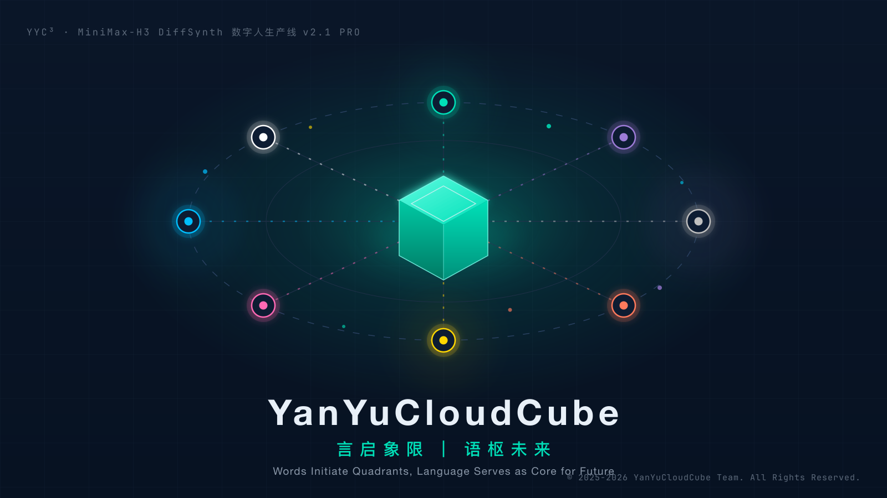

> ***YanYuCloudCube***
> *言启象限 | 语枢未来*
> ***Words Initiate Quadrants, Language Serves as Core for Future***
> *万象归元于云枢 | 深栈智启新纪元*
> ***All things converge in cloud pivot; Deep stacks ignite a new era of intelligence***

---
<div align="center">



# MiniMax-H3 DiffSynth 本地版 AI 数字人生产线

**v2.1 PRO · 五步闭环流水线 · 本地优先 · 数据主权 100%**


[](https://github.com/YYC-Cube/YYC3-MH3/actions/workflows/ci.yml)
[](https://github.com/YYC-Cube/YYC3-MH3/actions/workflows/deploy.yml)
[](https://github.com/YYC-Cube/YYC3-MH3)
[](https://mh3.yyc3.top)

`yanyucloudcube` · `yyc3` · `yyc3-mh3` · `minimax-h3` · `diffsynth` · `ai-digital-human` · `digital-human-production` · `five-step-pipeline` · `ai-family` · `multi-agent` · `seed-vault` · `prompt-engineering` · `local-first` · `data-sovereignty` · `pwa` · `react-19` · `next-16` · `tailwindcss-4` · `typescript-strict` · `github-pages`

> ***YanYuCloudCube***

> *言启象限 | 语枢未来*

> ***Words Initiate Quadrants, Language Serves as Core for Future***

> *万象归元于云枢 | 深栈智启新纪元*

> ***All things converge in cloud pivot; Deep stacks ignite a new era of intelligence***

</div>

---

## 📖 项目概述

> 「***YanYuCloudCube***」言启象限 | 语枢未来
>
> 「***Words Initiate Quadrants, Language Serves as Core for the Future***」
>
> 「***All things converge in cloud pivot; Deep stacks ignite a new era of intelligence***」

**MiniMax-H3 DiffSynth 本地版 AI 数字人生产线** 是一套面向创作者与运营者的专业级本地 AI 数字人视频生产平台。基于 **五步闭环流水线**（生成 → 评分 → 精评 → 归因 → 回写）构建，提供从提示词工程、Seed 种子资产沉淀、多 Agent 漫剧编排到多平台分发的全链路能力，全程 **本地离线运行**，保障 100% 数据主权。

### 五高架构 · 五标体系 · 五化转型

| 五高 | 五标 | 五化 |
| --- | --- | --- |
| 高可用 · 高性能 · 高安全 · 高扩展 · 高智能 | 标准化 · 规范化 · 自动化 · 可视化 · 智能化 | 流程化 · 数字化 · 生态化 · 工具化 · 服务化 |

---

## ✨ 核心功能

### 🎬 五步闭环流水线

| 阶段 | 名称 | 说明 | 关键指标 |
| --- | --- | --- | --- |
| 1 | 神经渲染 | DiffSynth H3 扩散采样 | 30 Steps / FP8 |
| 2 | 口型初评 | SyncNet 唇形音素对齐 | 误差 < 0.05s |
| 3 | 多模精评 | 表情 / 时序连续性 5 维评分 | 5 维雷达评分 |
| 4 | 缺陷归因 | 关键帧特征聚类排障 | 参数灵敏度 |
| 5 | Seed 迭代 | 优质基因回写种子库 | 闭环进化 |

### 🧭 13 大功能视图

| 视图 | 能力 |
| --- | --- |
| 设计规范中心 | DS Tokens 设计体系与全量组件库 |
| 总览驾驶舱 | 批次总览、产能统计、雷达评分 |
| 流水线工作台 | 五步闭环中栏调度、实时进度、一键采纳种子 |
| 批次详情 | 复盘分析、关键帧异常标注、缺陷修复追踪 |
| Seed 种子库 | S/A/B 级种子全生命周期、版本历史、变异衍生 |
| 提示词工程中心 | 高转化模板、变量插值、最佳实践沉淀 |
| 模型与算力 | DiffSynth 模型仓库、GPU Slot 显存管理 |
| 多 Agent 工作流 | 8 位 AI Family 节点编排、漫剧分镜协同 |
| 平台管理 | 多平台一键分发、媒体剪辑、数据回流分析 |
| 运维监控 | VRAM/GPU/CPU 实时指标、告警自愈 |
| 夜间批处理 | 12+ 批次夜间调度拓扑、无人值守 |
| 文档中心 | 内置 22 篇操作指南 |
| 系统设置 | 硬件限制、音素语言包、安全配置 |

### 🤖 YYC³ AI Family · 8 位家人协同

| 时钟位 | 家人 | 职能 |
| --- | --- | --- |
| 12:00 | 元启·天枢 | 总指挥 · 全局调度与闭环自愈 |
| 06:00 | 言启·千行 | 语言中枢 · 音素对齐与意图路由 |
| 07:30 | 语枢·万物 | 数据分析 · 多维特征评估 |
| 09:00 | 预见·先知 | 趋势预测 · 显存防爆预警 |
| 10:30 | 千里·伯乐 | 种子优选 · 基线推荐 |
| 13:30 | 智云·守护 | 安全守护 · 看门狗自愈 |
| 15:00 | 格物·宗师 | 质量仲裁 · 黄金准则 |
| 16:30 | 创想·灵韵 | 创意引擎 · 提示词魔术师 |

---

## 🛠️ 技术栈

| 层级　 | 技术　　　　　　　　　　　　　　　　　　　　　　　　 | 版本　　　　　　　 | 用途　　　　　　　　　　　　　　　　　　　　　|
| --------| ------------------------------------------------------| --------------------| -----------------------------------------------|
| 框架　 | React　　　　　　　　　　　　　　　　　　　　　　　　| 19.2　　　　　　　 | UI 渲染（StrictMode · automatic runtime）　　 |
| 框架　 | Next.js（App Router）　　　　　　　　　　　　　　　　| 16　　　　　　　　 | 路由 / 静态导出（Track B `output: "export"`） |
| 样式　 | Tailwind CSS　　　　　　　　　　　　　　　　　　　　 | 4　　　　　　　　　| 原子化样式（`@tailwindcss/postcss` 通道）　　 |
| 语言　 | TypeScript　　　　　　　　　　　　　　　　　　　　　 | 5.x（strict）　　　| 类型安全　　　　　　　　　　　　　　　　　　　|
| 图标　 | lucide-react　　　　　　　　　　　　　　　　　　　　 | 1.x　　　　　　　　| 图标库　　　　　　　　　　　　　　　　　　　　|
| 测试　 | Vitest + Testing Library　　　　　　　　　　　　　　 | 5.x / 16.x　　　　 | jsdom 冒烟测试　　　　　　　　　　　　　　　　|
| 字体　 | @fontsource（Inter / JetBrains Mono / Noto Sans SC） | 5.x　　　　　　　　| 自托管字体（离线可用）　　　　　　　　　　　　|
| 包管理 | pnpm　　　　　　　　　　　　　　　　　　　　　　　　 | 10+　　　　　　　　| 依赖管理　　　　　　　　　　　　　　　　　　　|
| 格式化 | oxfmt　　　　　　　　　　　　　　　　　　　　　　　　| 0.73　　　　　　　 | 代码格式化（代码域限定）　　　　　　　　　　　|
| 运行时 | Node.js　　　　　　　　　　　　　　　　　　　　　　　| 22（`.mise.toml`） | 工具链　　　　　　　　　　　　　　　　　　　　|

---

## 🚀 快速开始

### 环境要求

- Node.js ≥ 22（推荐通过 [mise](https://mise.jdx.dev/) 安装：`mise install`）
- pnpm ≥ 10（`npm i -g pnpm` 或 `mise use npm:pnpm`）

### 安装与启动

```bash
# 1. 克隆仓库
git clone https://github.com/YYC-Cube/YYC3-MH3.git
cd YYC3-MH3

# 2. 安装依赖（如全局 store 受限，可加 --store-dir .pnpm-store）
pnpm install

# 3. 启动开发服务器（默认端口 3031，scripts 内置 -p 3031）
pnpm dev
# ➜  Local: http://localhost:3031/

# 4. 生产构建（静态导出 out/）+ 预览
pnpm build
pnpm start
```

> 💡 团队规范：开发服务器端口自 `3030` 起；本项目默认 `3031`（3030 已由姊妹项目占用，经确认递增取位）。

### 登录说明

应用内置 **本地模拟认证**：任意账号 + 任意 ≥ 6 位密码即可登录，连续失败 5 次将触发 30 秒临时锁定（前端演示行为，不涉及真实鉴权）。默认演示身份为「本地超级管理员」。

### 在线访问与自动部署 🚢

| 通道 | 地址 | 说明 |
| --- | --- | --- |
| **在线站点** | <https://mh3.yyc3.top> | GitHub Pages · 自定义域（CNAME 已入库，域名校验 verified） |
| **代码仓库** | <https://github.com/YYC-Cube/YYC3-MH3> | Issue / PR / Releases |
| **CI 质检** | [workflows/ci.yml](.github/workflows/ci.yml) | 推送/PR main → 格式 + 类型 + 118 用例测试 + 双基座构建冒烟 |
| **CD 部署** | [workflows/deploy.yml](.github/workflows/deploy.yml) | 推送 main → Next 静态导出并部署 Pages（`build_type=workflow`） |

> 部署链：`configure-pages`（动态注入 `BASE_PATH`/`NEXT_PUBLIC_BASE_PATH`，自定义域/子路径双兼容）→ `next build`（`output: "export"` → `out/`）→ `upload-pages-artifact` → `deploy-pages`。产物含 `CNAME`（mh3.yyc3.top）/ `robots.txt` / `sw.js` / `manifest.webmanifest`，Pages 构建源为 **GitHub Actions**。

---

## 📜 可用脚本

| 命令 | 说明 |
| --- | --- |
| `pnpm dev` | 启动 Next.js 开发服务器（Turbopack · 端口 3031） |
| `pnpm build` | 生产构建（14 路由段静态导出 → `out/`） |
| `pnpm start` | 生产服务启动（Node 运行时轨 · 端口 3031） |
| `pnpm test` | 运行 Vitest 全量测试（118 用例 · 八类门禁） |
| `pnpm test:watch` | 监听模式运行测试 |
| `pnpm format` | oxfmt 代码格式化（代码域限定，见 `.oxfmtrc.json`） |
| `pnpm format:check` | oxfmt 格式检查（CI 门禁，不改写文件） |
| `pnpm typecheck` | TypeScript 严格类型检查（质量门禁） |

---

## ⌨️ 全局快捷键

| 快捷键 | 功能 |
| --- | --- |
| `Ctrl/⌘ + K` | 全局搜索（页面 / 批次 / 种子） |
| `Ctrl/⌘ + B` | 折叠 / 展开侧边栏 |
| `Ctrl/⌘ + /` | 唤起 YYC³ AI Family 协同面板 |

---

## 📁 项目结构

```
YYC3-MH3/
├── public/
│   ├── yyc3-family.png          # README 顶图 / 品牌横幅
│   ├── manifest.webmanifest     # PWA 清单（全端图标注册）
│   ├── robots.txt               # 爬虫策略（全站 Disallow · 本地优先隐私）
│   ├── sw.js                    # Service Worker（scope 相对化 · 离线缓存）
│   ├── CNAME                    # 自定义域（mh3.yyc3.top）
│   └── yyc3-icons/              # 全平台图标（PWA/Web/macOS/iOS/Android/watchOS）
├── src/
│   ├── app/                     # App Router 路由层
│   │   ├── layout.tsx           # 根布局（品牌 metadata + Provider 树 + AppShell）
│   │   ├── app-shell.tsx        # 应用外壳（登录守卫 + 导航三件套 + 全局弹窗群）
│   │   ├── page.tsx             # / → design-system
│   │   ├── dashboard/ … settings/  # 其余 12 路由段（视图零改动装配）
│   │   ├── contexts.tsx         # 五域 Context（Toast/Auth/生产数据/遥测/UIShell）
│   │   ├── navigation.ts        # useAppNavigate（副作用导航 hook）
│   │   └── sw-register.tsx      # PWA SW 注册（basePath 感知）
│   ├── index.css                # Tailwind v4 主题（DS Tokens）+ 自托管字体
│   ├── test/                    # Vitest 全局 setup
│   ├── __tests__/               # 八类测试门禁（118 用例）
│   ├── types/                   # 全量 TypeScript 类型定义
│   ├── data/                    # 模拟数据（批次/种子/Agent/AI Family 档案）
│   ├── domains/                 # 领域层（五域纯函数 + 出站端口）
│   ├── adapters/                # 适配层（local Registry BFF / memory 快照）
│   ├── components/
│   │   ├── common/              # 12 个基础组件（Button/Card/Modal/Toast…）
│   │   ├── navigation/          # Sidebar / Topbar / GlobalSearchModal（路由事实源）
│   │   ├── pipeline/            # PipelineBar / RadarScore / TerminalLog / VideoPreview
│   │   └── yyc3/                # YYC3FamilyModal / FloatingTrigger
│   └── views/                   # 13 大功能视图（路由级分割挂载）
├── server/                      # Registry BFF（registryApi 纯函数 + routeHandler 薄壳）
├── docs/                        # 团队标准规范 + 会话工作文档
│   └── assets/                  # 文档资源（横幅 SVG 源文件）
├── next.config.ts               # Next 配置（basePath 多基座 + 静态导出）
├── postcss.config.mjs           # Tailwind v4 PostCSS 通道
├── vitest.config.ts             # Vitest 配置（jsdom 冒烟测试）
├── tsconfig.json                # TypeScript strict 配置（Next 规范化接管）
├── .mise.toml                   # 工具链版本（Node 22 / pnpm）
└── package.json
```

---

## 🎨 设计体系

深色工业风指挥舱 UI，DS Tokens 定义于 [src/index.css](src/index.css)：

| Token | 值 | 用途 |
| --- | --- | --- |
| `--color-bg-primary` | `#0a1628` | 主背景 |
| `--color-brand` | `#00e0b8` | 品牌主色（青绿荧光） |
| `--color-info` | `#00b4d8` | 信息蓝 |
| `--color-purple` | `#9d7cd8` | 扩展紫 |
| `--color-danger` | `#ff7a45` | 告警橙红 |
| `--font-sans` | Inter + Noto Sans SC | 正文 |
| `--font-mono` | JetBrains Mono | 等宽数据 |

---

## 🤝 贡献与社区

我们欢迎任何形式的贡献！请先阅读以下文档：

- [贡献指南 (Contributing)](CONTRIBUTING.md) — 开发流程、质量门禁、提交规范
- [行为准则 (Code of Conduct)](CODE_OF_CONDUCT.md) — 社区协同公约
- [安全政策 (Security Policy)](SECURITY.md) — 漏洞报告与安全基线
- [许可证 (License)](LICENSE) — MIT

---

## 📄 许可证

本项目基于 [MIT License](LICENSE) 开源。

> 「***YanYuCloudCube***」
> 「***<admin@0379.email>***」
> 「***Words Initiate Quadrants, Language Serves as Core for the Future***」
> 「***All things converge in cloud pivot; Deep stacks ignite a new era of intelligence***」

**© 2025-2026 YanYuCloudCube Team. All Rights Reserved.**
