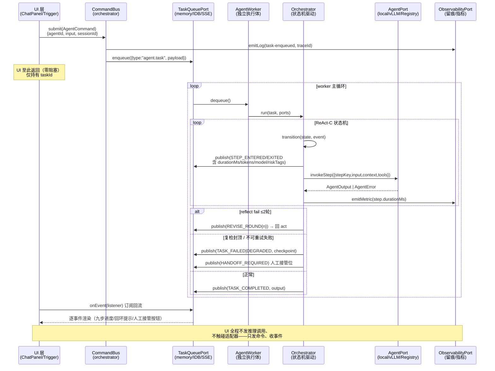

> ***YanYuCloudCube***
> *言启象限 | 语枢未来*
> ***Words Initiate Quadrants, Language Serves as Core for Future***
> *万象归元于云枢 | 深栈智启新纪元*

---

# 🧩 AI Family 八 Agent × ReAct-C 九步闭环 · 架构解耦设计

> 承接《[01-耦合治理与六域重构路线图](file:///Users/yanyu/YYC-Cube/YYC3-MH3/docs/YYC3-MH3-chief-architect-20261016/01-耦合治理与六域重构路线图.md)》与评分卡维度 9（Agent 健康 85 分）。
> 目标：**编排内核与 UI / Next.js 彻底解耦**，八 Agent 统一六要素接口，ReAct-C 由线性步进升级为**带回环的状态机**，任务队列事件化解耦 UI 与执行体，全部调用走 ports + 可替换适配器，全程留痕可审计。

## 〇、现状基线（以代码为准绳，2026-10-16 勘察）

| # | 现状 | 证据 | 与目标的差距 |
| --- | --- | --- | --- |
| 1 | `AiAssistantPort` 仅 2 方法（`listAgents` / `invokeAgent`），无 tools / trace / error 语义 | [ports.ts](file:///Users/yanyu/YYC-Cube/YYC3-MH3/src/domains/ai/ports.ts#L48-L53) | 六要素缺 4 项 |
| 2 | ReAct-C 为**线性环形步进**（`nextReactCStep` 取模），Step7 反思无质量判定、无回环 | [index.ts](file:///Users/yanyu/YYC-Cube/YYC3-MH3/src/domains/ai/index.ts#L60-L66) | 缺 Step7→Step5 回环与复检上限 |
| 3 | 九步上报是「一瞬间走完」（memory 桩同步循环 9 次 onStep），非真实执行推进 | [memory/aiAssistant.ts](file:///Users/yanyu/YYC-Cube/YYC3-MH3/src/adapters/memory/aiAssistant.ts#L73-L75) | 步进非状态机驱动 |
| 4 | `TaskQueuePort`（enqueue/dequeue/onEvent）已建成，但 **AI 调用未走队列**——UI 直调 invokeAgent | [queue/ports.ts](file:///Users/yanyu/YYC-Cube/YYC3-MH3/src/domains/platform/queue/ports.ts#L46-L50)、组合根 [composition.ts](file:///Users/yanyu/YYC-Cube/YYC3-MH3/src/app/composition.ts#L79-L80) | UI 与执行体未解耦 |
| 5 | 留痕 `AgentStepTrace` 仅 agentId/traceId/stepKey/label/index，**缺耗时、Token、模型名、风险标签** | [memory/aiAssistant.ts](file:///Users/yanyu/YYC-Cube/YYC3-MH3/src/adapters/memory/aiAssistant.ts#L32-L39) | 审计面不全 |
| 6 | **口径分裂**：AI Family 8 成员（[yyc3Data.ts](file:///Users/yanyu/YYC-Cube/YYC3-MH3/src/data/yyc3Data.ts)：yanqi/yushu/yujian/qianli/yuanqi/zhiyun/gewu/chuangxiang）vs 流水线 `AGENT_NODES` 5 节点（[agent.ts](file:///Users/yanyu/YYC-Cube/YYC3-MH3/src/data/agent.ts)） | 评分卡维度 9 已记录 | 需两层模型正名 |
| 7 | 适配器 2 实现：memory 桩 + local 回环通道（`createResilientGateway` 弹性网关可复用） | [local/aiAssistant.ts](file:///Users/yanyu/YYC-Cube/YYC3-MH3/src/adapters/local/aiAssistant.ts) | 缺 vLLM / Registry 独立实现 |

> **命名勘误**：用户清单中「知遇·伯乐」与代码不一致——代码为 **「千里·伯乐」（id: `qianli`）**（[yyc3Data.ts L98-L99](file:///Users/yanyu/YYC-Cube/YYC3-MH3/src/data/yyc3Data.ts#L98-L99)）。本设计以代码为准，不盲改数据。

**两层模型裁定（解决 8 vs 5 口径分裂）**：

```
┌─ 成员层（8）────────────────────────────┐   ┌─ 编排层（5 节点）──────────────────┐
│ AGENT_REGISTRY：八成员即八能力主体        │   │ AGENT_NODES：生产流水线工位拓扑      │
│ yanqi 语启千行 · yushu 语枢万物           │   │ node-1..5 引用 memberId，          │
│ yujian 预见先知 · qianli 千里伯乐         │──▶│ 描述「谁在哪个工位、产物流向谁」      │
│ yuanqi 元启天枢 · zhiyun 智云守护         │   │ （编排画布视图，非调用主体）          │
│ gewu 格物宗师 · chuangxiang 创想灵韵      │   └────────────────────────────────────┘
│ 每员可独立经 AgentPort 调用               │
└─────────────────────────────────────────┘
```

成员层为**调用主体**（invoke 的合法 agentId 全集 = 8 个 memberId）；编排层为**拓扑视图**（buildAgentTopology 消费，不产生新调用主体）。两层单一事实来源各自独立、引用单向（编排 → 成员）。

---

## 一、Agent 端口接口定义（六要素：input / context / tools / output / trace / error）

> 落位：`src/domains/ai/ports.ts` v2.1.0（域纯类型，零 UI/Next 依赖）。旧 `AiAssistantPort` v1 已随 PR-5 删除——删前实测全零 UI 生产消费（仅测试与组合根引用），组合根/契约测试已整体迁移 AgentPort v2（`ai-port.test.ts` v2 重写 +15 用例）。

```typescript
// ═══ 六要素之一：tools（能力显式注入，Agent 自身零 IO 能力）═══
/** Agent 可用工具（白名单显式注入——Agent 拿到什么就能用什么，无隐式能力） */
export interface AgentTool {
  /** 工具标识（编排器按名分发，Agent 代码不持有传输原语） */
  name: string;
  description: string;
  /** 结构化入参 schema（可选，供校验与文档生成） */
  inputSchema?: Record<string, unknown>;
  /** 由编排器代理执行（fetch/DB/文件等 IO 全部封在工具实现内，实现方为适配器） */
  invoke(input: unknown): Promise<unknown>;
}

// ═══ 六要素之二：input ═══
export interface AgentInput {
  /** 用户提示词 / 任务指令 */
  prompt: string;
  /** 结构化参数（模型温度、产出上限等，按 AgentProfile 声明的键校验） */
  params?: Readonly<Record<string, string | number | boolean>>;
}

// ═══ 六要素之三：context ═══
export interface AgentContext {
  /** 全链路追踪 id（贯穿九步每一步，缺失时由编排器新发） */
  traceId: string;
  /** 会话 id（多轮对话归属） */
  sessionId: string;
  /** 前序产物（上游 Agent 产出 / 检索片段 / 多轮历史摘要） */
  artifacts?: readonly string[];
  /** 本次调用预算（Token 上限 / 时限 ms，超限由编排器强制终局） */
  budget?: { maxTokens?: number; deadlineMs?: number };
}

// ═══ 六要素之四：output ═══
export interface AgentOutput {
  agentId: string;
  text: string;
  /** 置信度 [0,1]（Step7 反思判定的输入之一） */
  confidence: number;
  tokensUsed: number;
  /** 产出模型名（留痕审计必填，memory 桩填 "memory-stub"） */
  model: string;
  /** 风险标签（如 ["pii-masked","external-call"]；空数组 = 无风险） */
  riskTags: readonly string[];
  /** 结构化产物（下游 Agent context.artifacts 的供体） */
  artifacts?: readonly string[];
}

// ═══ 六要素之五：trace ═══
export interface AgentStepTrace {
  agentId: string;
  traceId: string;
  stepKey: ReactCStepKey;
  index: number;
  /** 步骤进入时刻（epoch ms） */
  startedAt: number;
  /** 步骤耗时（退场时回填） */
  durationMs?: number;
  tokensUsed?: number;
  model?: string;
  riskTags?: readonly string[];
  /** 回环轮次（Step7 fail 进入 revise 时 +1，首跑为 0） */
  reviseRound?: number;
}

// ═══ 六要素之六：error（结构化，携带可恢复性）═══
export type AgentErrorCode =
  | "unknown-agent"      // 未知 agentId（不可重试，回滚）
  | "tool-failed"        // 工具执行失败（可重试）
  | "budget-exceeded"    // 预算耗尽（可重试，须缩参）
  | "contract-violated"  // 供数契约校验失败（可重试一次后转降级）
  | "reflect-unresolved" // 复检 ≤2 轮仍不达标（转人工接管）
  | "cancelled";         // 人工取消

export interface AgentError extends Error {
  code: AgentErrorCode;
  /** 是否可自动重试（编排器据此走 retry / rollback / handoff 三分支） */
  retryable: boolean;
  traceId: string;
  agentId: string;
  /** 发生时所处的 ReAct-C 步骤 */
  stepKey?: ReactCStepKey;
}

/** ═══ 统一 Agent 端口（八成员 × N 适配器共同遵守的唯一调用契约）═══ */
export interface AgentPort {
  /** 成员档案（8 员全集，浅拷贝防外泄） */
  listAgents(): Promise<readonly AgentProfile[]>;
  /**
   * 单步推进式调用（编排器驱动状态机，每步传 stepKey）：
   * 适配器只负责「给定步骤做一次推理/执行」，九步编排权在 orchestrator——
   * 这是与 v1 的本质区别：v1 适配器自走九步，编排权错位。
   */
  invokeStep(request: {
    agentId: string;
    stepKey: ReactCStepKey;
    input: AgentInput;
    context: AgentContext;
    tools: readonly AgentTool[];
  }): Promise<AgentOutput>;
}
```

**AgentProfile**（成员层注册表）由既有 `YYC3_MEMBERS` 派生 8 条（id/name/roleDefinition/capabilities 直读，**不复制数据**），并声明默认模型与风险标签基线。

> ⚠️ **落位修正（v1.0.1，PR-1 实测裁定）**：首版拟落位 `domains/ai/registry.ts` 直读 YYC3_MEMBERS——boundary-guard 铁律**domains 仅允许 types + kernel，domains→data 为越界**。实测修正为：`AgentProfile` 类型落 `src/types/ai.ts`（data 与 domains 共同可见的唯一合法层），`AGENT_REGISTRY` 落 `src/data/aiRegistry.ts`（data→types 放行，与 AGENT_NODES 同层同语义）。域层 AgentPort 仅以类型引用 AgentProfile，零数据依赖。

```typescript
export interface AgentProfile {
  id: string;                 // 8 成员 id（qianli 千里伯乐 以代码为准）
  name: string;               // 言启·千行 等
  roleDefinition: string;
  capabilities: readonly string[];
  /** 默认推理模型（适配器可按 profile.model 路由：MiniMax-Text-01 / vLLM 部署名等） */
  defaultModel: string;
  /** 风险基线（如 zhiyun 守护 = ["local-only"]，出站适配器不得为其加外部调用工具） */
  riskTags: readonly string[];
}
```

---

## 二、九步状态机（Step7 回环 Step5，复检 ≤2 轮）

> 落位：`src/domains/ai/machine.ts`（新，纯函数 transition，零副作用）。`REACT_C_STEPS` 常量与 `buildAgentTopology` 原样复用。

**转移规则**（`ReactCMachine.transition(state, event) → state`）：

| 当前步 | 事件 | 下一态 | 说明 |
| --- | --- | --- | --- |
| idle | SUBMIT | perceive(1) | 任务入队后启动 |
| 1→6 线性 | STEP_OK | 下一步 | 正常推进 |
| 5 act | STEP_FAIL(tool-failed/retryable) | 5 act（重试计数+1） | 步内重试（≤3 次，指数退避） |
| 6 observe | OBSERVED | 7 reflect | 观察喂给反思 |
| 7 reflect | VERDICT(pass) | 8 revise | 达标 → 固化前修整 |
| 7 reflect | VERDICT(fail) 且 reviseRound<2 | **8 revise**（reviseRound+1） | 修正后回环 |
| 8 revise | REVISED | **5 act** | **回环：重执行 → 再观察 → 复检** |
| 7 reflect | VERDICT(fail) 且 reviseRound≥2 | 9 consolidate(degraded) | 复检 2 轮封顶，强制终局 |
| 9 consolidate | STEP_OK | done | 闭环完成（落经验资产） |
| 任意 | ERROR(non-retryable) / CANCEL / 预算超限 | failed / rolled-back | 零部分状态外泄 |
| failed | HANDOFF | handoff-required | 转人工，UI 告警 + 断点 checkpoint |

```mermaid
stateDiagram-v2
    [*] --> perceive : SUBMIT(队列派发)
    perceive --> reason : STEP_OK
    reason --> retrieve : STEP_OK
    retrieve --> plan : STEP_OK
    plan --> act : STEP_OK
    act --> observe : STEP_OK
    observe --> reflect : OBSERVED

    reflect --> revise : VERDICT pass
    reflect --> revise_fail : VERDICT fail\n且 reviseRound < 2
    reflect --> consolidate_degraded : VERDICT fail\n且 reviseRound ≥ 2\n（复检封顶）

    state revise_fail as "revise (第N轮修正)"
    revise_fail --> act : REVISED 回环重执行

    revise --> act : REVISED
    act --> act : STEP_FAIL 步内重试 ≤3

    consolidate_degraded --> done : 强制终局(留风险标签)
    revise --> consolidate : 固化经验
    consolidate --> done : 闭环完成

    note right of reflect
      复检上限 = 2 轮
      每轮路径: 7→8→5→6→7
      第3次仍fail → degraded 终局
      + handoff-required 事件
    end note

    done --> [*]
```

> **双通道裁定（v1.0.3，PR-3 实测落定）**：`TaskQueuePort.onEvent` 事件类型锁定四值（enqueued/dequeued/completed/failed），无法承载九步进度语义——裁定为**双通道**：命令走 TaskQueuePort（QueueTask.payload = AgentCommand），进度事件走编排内核自持 EventBusPort（内存广播 + 监听器故障隔离）；**boundary-guard 实测拦截新顶层目录逃逸**（白名单层扫描），orchestrator 已入矩阵（允许 types/kernel/domains，禁 data/adapters/UI——agentId 校验经 AgentPort.listAgents 供数）。禁令守卫升级为**词面级静态扫描**（orchestrator 目录零 react/next/document/window/localStorage/fetch/XHR/WebSocket，连注释词面也不豁免）。落位：[protocol.ts](file:///Users/yanyu/YYC-Cube/YYC3-MH3/src/orchestrator/protocol.ts)（AgentCommand/TaskCheckpoint/AgentTaskEvent/EventBusPort）· [runner.ts](file:///Users/yanyu/YYC-Cube/YYC3-MH3/src/orchestrator/runner.ts)（状态机驱动 + 预算 >= 语义 + checkpoint）· [resilience.ts](file:///Users/yanyu/YYC-Cube/YYC3-MH3/src/orchestrator/resilience.ts)（断点存储/回滚摘要/resumeCommand）· [command-bus.ts](file:///Users/yanyu/YYC-Cube/YYC3-MH3/src/orchestrator/command-bus.ts)（taskId 幂等）· [worker.ts](file:///Users/yanyu/YYC-Cube/YYC3-MH3/src/orchestrator/worker.ts)（注入式调度泵），26 契约用例锁死。

**计数语义**（消除歧义）：`reviseRound` 初始 0；每次 `VERDICT(fail)` 进入 revise 时 +1；`reviseRound > 2` 时不再回环，强制 `consolidate(degraded)`。即**最多 2 次回环复检（7→8→5→6→7），第 3 次 reflect fail 必然终局**。

> **实现裁定（v1.0.2，PR-2 实测落定，消除上图双出边歧义）**：
> ① 状态图 `revise` 同时画有 `→ act` 与 `→ consolidate` 两条出边——裁定为**按末次裁决分流**：`REVISED` 事件读 `verdicts` 末条，pass → consolidate（固化前修整），fail → act（回环重执行）。
> ② `consolidate` 的出口为 `STEP_OK → done`（STEP_OK 分支特判沉淀步；线性步 perceive..act 与沉淀步共用 STEP_OK 事件但路由不同）。
> 两裁定均由 [machine.ts](file:///Users/yanyu/YYC-Cube/YYC3-MH3/src/domains/ai/machine.ts) + 29 契约用例锁死。

**关键纯函数签名**：

```typescript
export type ReactCEvent =
  | { type: "SUBMIT" } | { type: "STEP_OK"; output: AgentOutput }
  | { type: "STEP_FAIL"; error: AgentError }
  | { type: "OBSERVED"; observation: string }
  | { type: "VERDICT"; pass: boolean; score: number }
  | { type: "REVISED" } | { type: "CANCEL" } | { type: "HANDOFF" };

export interface ReactCState {
  step: ReactCStepKey | "idle" | "done" | "failed" | "handoff-required";
  reviseRound: number;          // 回环轮次 [0,2]
  stepRetries: number;          // 步内重试 [0,3]
  verdicts: readonly { pass: boolean; score: number; at: number }[];
  degraded: boolean;            // 复检封顶强制终局时为 true
}

export function transition(state: ReactCState, event: ReactCEvent): ReactCState;
// 非法转移抛 AgentError(code="contract-violated")——状态机自身也是被契约测试锁死的
```

> 判定来源：`VERDICT` 事件由编排器根据 Step7 的 `AgentOutput`（confidence + 领域评分规则）合成——**判定规则在域层纯函数**（`evaluateReflect(output, thresholds)`），编排器只搬运，适配器不裁决。

---

## 三、任务队列与 Agent 交互时序（UI 发命令 → worker 执行 → 事件回流）

> 复用既有 `TaskQueuePort`（onEvent 通道已具备）；新增**命令/事件载荷契约**落位 `src/orchestrator/protocol.ts`。



**协议契约**（`src/orchestrator/protocol.ts`）：

```typescript
/** UI → 编排：命令（唯一入队载荷） */
export interface AgentCommand {
  kind: "agent.invoke";
  taskId: string;            // 幂等键（UI 生成 uuid，重发去重）
  agentId: string;           // ∈ AGENT_REGISTRY 8 员
  input: AgentInput;
  sessionId: string;
  /** 人工接管恢复时携带断点（首跑缺省） */
  resume?: { traceId: string; state: ReactCState };
}

/** 编排 → UI：事件（onEvent 回流，全部携带 traceId） */
export type AgentTaskEvent =
  | { type: "TASK_ACCEPTED"; taskId: string; traceId: string; at: number }
  | { type: "STEP_ENTERED"; taskId: string; traceId: string; step: AgentStepTrace }
  | { type: "STEP_EXITED";   taskId: string; traceId: string; step: AgentStepTrace & { durationMs: number } }
  | { type: "REVISE_ROUND";  taskId: string; traceId: string; round: 1 | 2; reason: string }
  | { type: "TASK_COMPLETED"; taskId: string; traceId: string; output: AgentOutput; totalMs: number }
  | { type: "TASK_DEGRADED";  taskId: string; traceId: string; output: AgentOutput; reviseRound: 2 }
  | { type: "TASK_FAILED";    taskId: string; traceId: string; error: AgentError }
  | { type: "HANDOFF_REQUIRED"; taskId: string; traceId: string; checkpoint: ReactCState };
```

**worker 形态**（三态同构，编排器零改动）：

| 形态 | 宿主 | 适用 |
| --- | --- | --- |
| 页面内 worker（默认） | `setTimeout` 宏任务泵（RSC/SSR 安全） | 本地优先默认路径，零额外基建 |
| Web Worker | `worker_threads` 同构封装 | 重推理不挤占主线程 |
| Node 常驻 worker | server 侧进程，队列经 SSE 桥 | 批量长任务 / vLLM 后端 |

---

## 四、模块抽离与 PR 拆分

### 4.1 目标目录结构（orchestrator 与 UI/Next 零依赖，可整体抽包）

```
src/
├── types/ai.ts                  # AgentProfile 六字段契约（v1.0.1 修正落位）
├── data/aiRegistry.ts           # AGENT_REGISTRY 8 员派生（boundary：domains 禁触 data）
├── domains/ai/                  # 域层（已有，扩展）
│   ├── ports.ts                 # v2：AgentPort 六要素（§一）
│   ├── machine.ts               # 新：ReactC 状态机 transition + evaluateReflect
│   └── index.ts                 # 保留 REACT_C_STEPS / topology（单一事实来源）
├── orchestrator/                # ★ 新内核（禁 import react/next/dom/localStorage）
│   ├── protocol.ts              # AgentCommand / AgentTaskEvent 契约
│   ├── command-bus.ts           # submit → enqueue（幂等去重 + traceId 发放）
│   ├── runner.ts                # 状态机驱动循环（事件发布 / 预算强制 / checkpoint）
│   ├── worker.ts                # dequeue 泵（三态同构：宏任务/WebWorker/Node）
│   ├── resilience.ts            # 重试策略 / 回滚（零部分状态）/ handoff 状态落盘
│   └── tools/                   # 工具注册表（白名单装配，IO 全在此层实现内）
├── adapters/
│   ├── ai-local/                # 重构：现有 local 通道对齐 invokeStep 契约
│   ├── ai-vllm/                 # 新：OpenAI-compatible /v1/chat/completions
│   ├── ai-registry/             # 新：经 server/registryApi BFF（复用弹性网关）
│   └── memory/aiAssistant.ts    # 桩：对齐 invokeStep（测试/断网默认）
└── app/
    ├── composition.ts           # 组合根：ai: AgentPort 装配切换（env 驱动）
    └── （UI 组件只经 usePorts().ai 编排通道 + onEvent 订阅，禁直调适配器）
```

### 4.2 PR 拆分（每 PR 独立可合并、门禁全绿、可回滚）

| PR | 内容 | 抽离/新建模块 | 验收门禁（唯一判据） |
| --- | --- | --- | --- |
| **PR-1** | 域契约 v2 | `domains/ai/ports.ts` 升级 + `registry.ts`（8 员派生） | `pnpm typecheck` 0 error；`pnpm test`（registry 8 员快照 + 端口形状契约）全绿；`check:circular` 0 环 |
| **PR-2** | 九步状态机 | `domains/ai/machine.ts`（transition + evaluateReflect） | 契约测试 ≥15 用例：线性推进 / 回环路径 7→8→5→6→7 / 复检封顶 degraded / 非法转移抛错 / 计数边界（reviseRound=2） |
| **PR-3** | 编排内核 | `orchestrator/` 五模块 | 假时钟测试：任务全生命周期事件序列断言 / 预算超限强制终局 / 重试退避 / checkpoint 落盘恢复；**grep 断言零 `react`/`next` import** |
| **PR-4** | 适配器矩阵 | `adapters/ai-{local,vllm,registry}` + memory 桩对齐 + 组合根 env 切换 | 三适配器同端口契约测试（invokeStep 形状 / 降级路径 / 契约校验失败转 retry）；`check:knip` 0 |
| **PR-5** | UI 改接 + 禁令收口 | ChatPanel/Trigger 改命令+事件流；eslint no-restricted + boundary-guard 扩展；删除 v1 `invokeAgent` 兼容层 | `check:lint` 0 error；boundary-guard 新增禁令矩阵（§五）全绿；workbench/seedvault 集成测试回归全绿 |

**依赖链**：PR-1 → PR-2 → PR-3 → {PR-4, PR-5}（后两者可并行）。任一 PR 红灯即止，不带病合并。

---

## 五、禁令清单与三层守卫（DOM / localStorage / fetch）

**裁定**：Agent 与编排内核是纯逻辑层，一切 IO 能力（网络、存储、DOM）只能以 **AgentTool 白名单**（§一）或 **Port 注入**（§三）形式存在于适配器层。违反即破坏「本地优先 + 可审计 + 可替换」三根基。

| 禁令 | 静态守卫（提交即拦） | 运行时守卫 | 测试守卫 |
| --- | --- | --- | --- |
| ❌ 直接操作 DOM<br/>（document/window/Element） | eslint `no-restricted-globals: [error, document, window]` + `no-restricted-properties` 作用于 `src/domains/**` `src/orchestrator/**` `src/adapters/**` | 编排器不触 DOM；UI 渲染仅消费 AgentTaskEvent | boundary-guard 新增矩阵：`grep -E "document\. | window\." src/orchestrator src/domains/ai` 期望 0 命中 |
| ❌ 直接读 localStorage<br/>（含 sessionStorage） | 同上规则集加 `localStorage, sessionStorage`；checkpoint 持久化唯一通道 = `StoragePort`（IDB/memory 适配器） | worker 恢复断点只经注入的 `StoragePort` | 契约测试断言 `resilience.checkpoint` 仅调用注入替身 |
| ❌ 直接 fetch<br/>（含 XHR/WebSocket） | `no-restricted-syntax` 禁 `CallExpression[callee.name=/^fetch$ | XMLHttpRequest | WebSocket/]` 于同范围；网络唯一出口 = 适配器内 `createResilientGateway` / AgentTool 实现 | Agent 拿到的 `tools` 是编排器白名单子集——**能力最小化，无网即无网** | adapters 契约测试用注入 fetch 替身；orchestrator 测试零网络断言（未注入时 invoke 抛 `contract-violated`） |

**三层落位**：

```bash
# 静态（PR-5 落地，进 check:lint 门禁）
pnpm check:lint        # orchestrator/domains/adapters 命中禁令 → exit 1

# 测试（PR-3 起随全量测试）
pnpm test              # boundary-guard 矩阵 + 零网络/零存储契约断言

# 审计（佐证链复用）
grep -rnE "document\.|window\.|localStorage|sessionStorage|\bfetch\(" \
  src/orchestrator src/domains/ai src/adapters/ai-* | wc -l   # 期望：0
```

> **PR-5 落地注记（v1.0.4 实测）**：eslint 禁令块已入 `check:lint` 门禁，作用域为 `src/orchestrator/**` + `src/domains/**`（no-restricted-globals：document/window/localStorage/sessionStorage/fetch/XMLHttpRequest + no-restricted-syntax：`NewExpression[WebSocket]`）。与上表设计的一处偏差及裁定：**adapters 层不在 eslint 禁令范围**——适配器是合法 IO 出口（`fetch` 是其职责本体，网络收口靠 `createResilientGateway` 统一通道与矩阵契约测试的注入替身）；词面级零豁免扫描（连注释不拦）由 boundary-guard 在 orchestrator 层承接，eslint 规则面管标识符引用（编辑器即时反馈），两层互补。实测：存量零违规（domains 4 处词面全在注释），lint 全绿。

**工具白名单装配示例**（组合根，能力显式可见、可审计）：

```typescript
// composition.ts —— zhiyun（守护）为例：local-only 基线 → 只装配本地工具
const zhiyunTools = buildToolbelt("zhiyun", [
  watchdogProbeTool,       // 探活（适配器实现，编排器代理执行）
  memorySweepTool,
]);                        // 产出集不含任何网络工具 → 该 Agent 结构性无外联能力
```

---

## 六、能力边界（诚实声明 · 不夸大）

- 本文件为**设计裁定**，代码未动；全部落地以 PR-1..5 门禁实测为准（评分卡维度 9 现状 85 分，全部合并后按验收数值复评）。
- vLLM / Registry 适配器在 PR-4 提供**契约实现 + 本地回环实测**；真实 GPU 集群连通性、SSE 流式、token 计量精度需部署窗口另证（评分卡 12.8 既有边界延续）。
- 状态机判定 `evaluateReflect` 的阈值基线首版取保守常量（confidence ≥ 0.75 且无 error 风险标签），工业级校准需真实流量数据。
- 「千里·伯乐」命名以代码为准；若产品侧确认改「知遇·伯乐」，属 PR-1 数据变更（单行 diff + 快照测试同步），不阻塞架构落地。

---

## 变更历史

| 版本 | 日期 | 变更内容 | 作者 |
| --- | --- | --- | --- |
| v1.0.4 | 2026-10-16 | PR-4/PR-5 落地：适配器矩阵四实现（memory 确定性桩 / ai-local 韧性网关 / ai-vllm OpenAI 兼容+构造期守卫 / ai-registry BFF，矩阵契约 14 用例）；UI 改接收口——v1 端口与桩删除（全零 UI 生产消费实测）、组合根迁移 v2、`app/agent-runtime.ts` 客户端单例（env 适配器切换 + worker 常驻 + 取消表，9 用例）、eslint 禁令块入门禁（orchestrator+domains，adapters 合法 IO 出口豁免——偏差裁定见 §五落地注记）、boundary-guard 矩阵放行 app⇒orchestrator；全量门禁 369 用例绿 | Chief Architect |
| v1.0.3 | 2026-10-16 | PR-3 落地：orchestrator 五模块（protocol/runner/resilience/command-bus/worker，26 用例）实测；§三 补录双通道裁定 + boundary 矩阵新增 orchestrator 层 + 禁令词面级扫描（连注释不豁免） | Chief Architect |
| v1.0.2 | 2026-10-16 | PR-2 落地：machine.ts（transition + evaluateReflect，29 用例）实测；§二 补录两条实现裁定（REVISED 按末次裁决分流 / consolidate 经 STEP_OK→done），消除状态图双出边歧义 | Chief Architect |
| v1.0.1 | 2026-10-16 | PR-1 实施落位修正：AgentProfile → types/ai.ts、AGENT_REGISTRY → data/aiRegistry.ts（boundary-guard 铁律 domains 禁触 data，留痕勘误）；PR-1 已实测落地 | Chief Architect |
| v1.0.0 | 2026-10-16 | 首版：现状勘察 7 项基线 + 六要素端口 v2 + 八成员两层模型裁定 + 九步状态机（Step7→Step5 回环、复检 ≤2 轮）+ 队列事件化时序 + PR-1..5 拆分 + 三层禁令守卫 | Chief Architect |

---

<div align="center">

> 「***YanYuCloudCube***」
> 「***<admin@0379.email>***」
> 「***Words Initiate Quadrants, Language Serves as Core for the Future***」
> 「***All things converge in cloud pivot; Deep stacks ignite a new era of intelligence***」

**© 2025-2026 YanYuCloudCube™. All Rights Reserved.**

</div>
